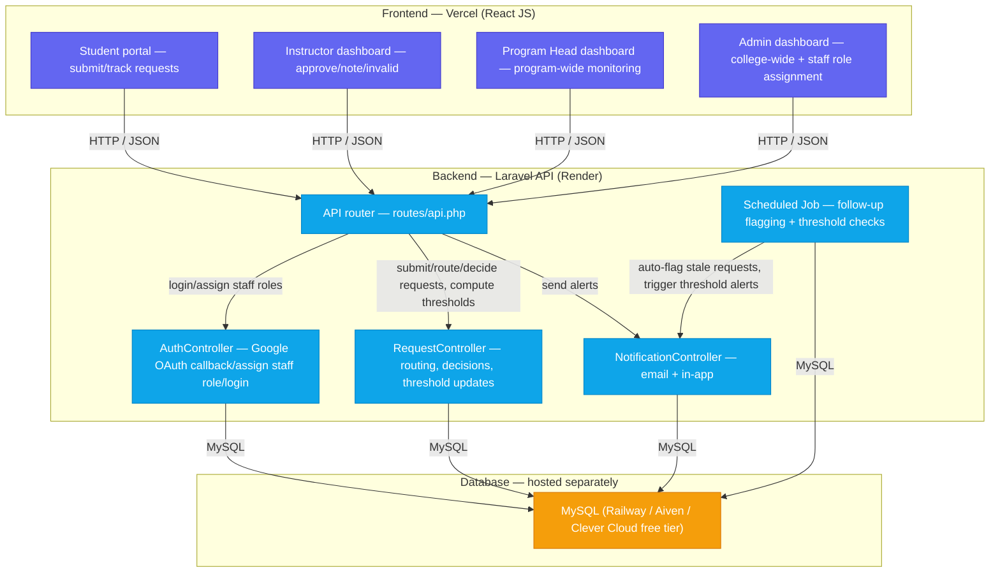

# ALRM — Absenteeism, Late Report, and Excuse Letter Management System
### Implementation Documentation (v1.0 / MVP)

---

## 1. System Overview

**ALRM** is a web-based **Absence/Tardiness Monitoring and Approval System** built for **La Verdad Christian College, Inc. (LVCC)**, digitizing and automating the current manual absenteeism, late report, and excuse-letter process at the College Secretary's Office — currently done through Google Forms, spreadsheets, and Viber.

**Problem being solved:**
The current process depends on manual, one-by-one coordination across disconnected tools, with no proactive mechanism to catch problems before they escalate:
- The College Secretary is a single point of bottleneck, manually forwarding every form to instructors one by one via Viber.
- The system relies on 3 disconnected tools (Google Forms, spreadsheets, Viber/Messenger) with no centralized dashboard.
- There is no proactive alert before a student's absence/late count escalates — intervention only happens after the fact.
- Requests can be overlooked as volume grows, since there's no way to track who has/hasn't responded.

**Solution:** A centralized platform that:
- Automatically routes a student's excuse/late request to the *correct* instructor based on subject/class schedule (no manual forwarding).
- Gives every role a real-time, role-scoped dashboard.
- Automatically enforces attendance policy logic (3 lates = 1 absence, 2/3-absence alerts).
- Flags unanswered requests for Program Head follow-up so nothing gets lost.

**Important scope note:** ALRM does **not** change who holds authority over attendance decisions. Instructors still decide validity; Program Heads still intervene. ALRM's job is limited to **routing, tracking status, and surfacing bottlenecks** — supporting the existing approval process, not replacing the people in it.

**Target users:**
| Role | Device | Access |
|---|---|---|
| Student | Own phone | Login via Google SSO (`@student.laverdad.edu.ph`) — auto-approved on first login, no waiting on Admin |
| Instructor | Any device/tablet | Login (approves/denies/notes requests for own classes) |
| Program Head | Any device | Login (monitors entire program, no independent approval authority) |
| Administrator | Any device | Login (college-wide visibility, staff role assignment, reports) |

---

## 2. Tech Stack

*(As mandated by the High-Level Technical Requirements Guide)*

| Layer | Technology | Notes |
|---|---|---|
| Frontend | **React JS** | SPA, view/route adjusts based on role |
| Backend | **Laravel** (PHP) | REST API, business logic, validation, auth |
| Database | **MySQL** | Recommended by the guide; used both locally and in production |
| Styling | Tailwind CSS (or Bootstrap/Material UI) | Any suitable CSS/UI library is allowed |
| Auth | Google OAuth/SSO (Laravel Socialite) | School-email-domain-restricted (see [Email Domain Rules](#email-domain-rules) below); no email/password self-registration — Google Workspace membership is the identity check. Students are auto-approved on first login; staff still need Admin to assign their specific role (Instructor/Program Head/Admin) |
| Notifications | Email (Laravel Mail) + In-app | Per Admin/Student interviews — email + in-app preferred over Messenger/Viber for the *official* channel |
| Frontend hosting | Vercel | Required to be publicly deployed for final presentation |
| Backend hosting | Render | Required to be publicly deployed for final presentation |

> ⚠️ The technology stack is **fixed by the course requirements** — React JS + Laravel is non-negotiable, unlike Mesado where the stack was a free choice.

### Email Domain Rules

LVCC uses two separate institutional Google Workspace domains, which the system uses to auto-detect the correct role at registration time:

| User type | Email domain | Maps to role |
|---|---|---|
| Student | `@student.laverdad.edu.ph` | `student` |
| Faculty / Staff (Instructor, Program Head, Admin) | `@laverdad.edu.ph` | `instructor` / `program_head` / `administrator` (assigned by Admin on approval) |

**Login logic (Google OAuth, not a registration form):**
- On the Google OAuth callback, the backend validates the email against these two domains — anything outside both is rejected, even if Google auth itself succeeded.
- If the domain is `@student.laverdad.edu.ph` → account is created (or matched, on return visits) with `role = student`, `status = approved` immediately. **No Admin step for students at all** — Google Workspace membership already is the identity check, so a separate approval gate would just be redundant friction.
- If the domain is `@laverdad.edu.ph` → account is created as `pending`, and the **Administrator assigns** the specific staff role (Instructor, Program Head, or Administrator), since the domain alone doesn't distinguish between those three. This is role *assignment*, not a legitimacy check — Google already handled that part.
- **One person who is both Instructor and Program Head:** rather than a full multi-role system, `users.role` stays single-valued (e.g. `instructor`), and Program Head access for that person is granted via the existing `PROGRAMS.program_head_id` FK as a secondary check — if a user's ID shows up as `program_head_id` on any program, they get Program Head views/routes in addition to their primary role. No extra approval step, no schema change. A true many-role-per-user system (pivot table) is deferred — see Phase 5.

---

## 2.1 Deployment Architecture

Same 3-tier separation as Mesado (Frontend → API → DB, all independently hosted):



**Why this matters for your case specifically:** just like Mesado, **Render's free tier has no persistent disk**, so a self-hosted MySQL container on Render will lose data on every redeploy. Use a separately-hosted free MySQL provider (Railway, Aiven, or Clever Cloud) and point Laravel's `.env` to it — same pattern as Mesado's use of TiDB Cloud.

**Local dev vs. Production `.env`:**

| | Local Dev | Production |
|---|---|---|
| `DB_CONNECTION` | mysql | mysql |
| `DB_HOST` | 127.0.0.1 | Hosted MySQL provider's gateway host |
| `DB_PORT` | 3306 | provider-specific (varies) |
| `DB_DATABASE` | alrm | alrm |
| SSL required | No | Usually yes — check provider docs |

---

## 3. Core Features (MVP Scope)

### Student Flow
1. Login via Google SSO using `@student.laverdad.edu.ph` → auto-approved on first login, no waiting on Admin
2. Submit a digital excuse/late request: subject, date(s), type (absence/late), reason, supporting document upload (e.g., medical certificate)
3. System **auto-identifies the correct instructor** based on subject/class schedule — no manual routing
4. Track request status in real time: `pending → approved / noted / invalid`
5. View own request history and how many absences/lates they've accumulated relative to the 2/3-count triggers
6. Cannot edit/withdraw a submitted request — must submit a new one if there was an error (per Admin interview: old one still exists as a record)

### Instructor Dashboard
7. See pending requests for their own classes only
8. Mark a request as **Approved**, **Noted**, or **Invalid**
9. View: most-absent students in their class, per-student absence count, program/subject context, most common absence reasons, flagged invalid-reason students
10. Get notified (email + in-app) when: a new request is submitted, a student hits 2 absences (warning) or 3 absences (IR/minor offense)

### Program Head Dashboard
11. Same view as Instructor dashboard, but aggregated across the **entire program** (all instructors/sections)
12. Monitor students flagged for intervention — does **not** independently approve/deny requests, only reviews the instructor's decision + documentation
13. Receives auto-escalated requests that an Instructor hasn't acted on within the response window
14. Case-specific handling: for medical absences, track referral to formal leave-of-absence filing; for recurring cases, track "letter of commitment" intervention
15. Full audit trail visibility

### Administrator
15. College-wide dashboard (all programs)
16. CRUD programs and classes (subject, instructor, schedule, program)
17. Exportable reports (PDF/Excel) for accreditation purposes

### System Automation (Backend Logic)
18. **Auto-routing** — request → correct instructor, based on subject/class schedule, no manual forwarding
19. **Policy enforcement** — 3 lates automatically convert to 1 absence, tracked as a running count
20.  **Threshold alerts** — 2 absences = warning notification; 3 absences = IR/minor-offense notification, sent to Instructor + Program Head
21. **Follow-up flagging** — a request unanswered past a defined time window is auto-flagged to the Program Head
22. **Auto-generated confirmation** — once approved, the system generates the student's evidence/confirmation record automatically (no manual re-send step)

### Deferred to Phase 2 (not in MVP)
- SMS/Viber as a notification channel
- Advanced analytics/trend charts across terms
- Automatic blocking of retake eligibility once threshold is crossed (currently informational + manual endorsement to Discipline Office)

---

## 4. Database Schema

> **Note:** the schema below reflects the final ERD (see `ATTENDANCE_drawio.png`), which merges/renames a few tables from the earlier draft — `subjects` + `class_schedules` are combined into `CLASSES`, and `excuse_requests` is renamed `REQUESTS`. Table names below use the ERD's actual naming.

### `user`
| Field | Type | Notes |
|---|---|---|
| id | bigint (PK) | |
| name | string | |
| email | string, unique | must match `@student.laverdad.edu.ph` (student) or `@laverdad.edu.ph` (staff) — see [Email Domain Rules](#email-domain-rules) |
| google_id | string, nullable | Google's unique subject ID from OAuth — used to match returning users on login |
| password | string, hashed, nullable | kept nullable since accounts are created via Google OAuth, not a password form |
| role | enum, nullable | `administrator`, `program_head`, `instructor`, `student` — null for staff until Admin assigns |
| program_id | bigint (FK → PROGRAMS), nullable | for students/program heads/instructors |
| status | enum, nullable | `approved` (auto, for students) or `pending` (staff, until Admin assigns their specific role) — students never sit in `pending` |
| created_at / updated_at | timestamp | |

### `PROGRAMS`
| Field | Type | Notes |
|---|---|---|
| id | bigint (PK) | |
| program_name | string | e.g. "BS Information Systems" |
| program_head_id | bigint (FK → user), nullable | the specific Program Head assigned to this program |

### `CLASSES`
| Field | Type | Notes |
|---|---|---|
| id | bigint (PK) | |
| subject_name | string | |
| instructor_id | bigint (FK → user) | |
| schedule | string / structured time | used to compute "late" (arrival within 20 mins = late) |
| program_id | bigint (FK → PROGRAMS) | |

### `ENROLLMENTS`
| Field | Type | Notes |
|---|---|---|
| id | bigint (PK) | |
| student_id | bigint (FK → user) | |
| class_id | bigint (FK → CLASSES) | |

### `ATTENDANCE_TRACKER`
| Field | Type | Notes |
|---|---|---|
| id | bigint (PK) | |
| enrollment_id | bigint (FK → ENROLLMENTS) | one tracker per student per class |
| **total_lates** | integer | raw late count, *before* conversion |
| total_absences | integer | raw absence count (does **not** include lates-converted-to-absences) |
| converted_absences | integer, computed | `total_absences + floor(total_lates / 3)` — this is the count checked against the 2/3-absence triggers |
| status | enum | `safe`, `warning` (2 absences), `IR` (3 absences) |

> **Scope note:** ALRM tracks absence/late **counts** only — it does not log per-session attendance or compute a percentage against total class meetings. Both the 2-absence warning and 3-absence IR trigger are count-based, matching how the institution actually flags cases today. ALRM only comes into play when a student *files* an absence/late request; it does not require instructors to log attendance session-by-session.

### `REQUESTS`
| Field | Type | Notes |
|---|---|---|
| id | bigint (PK) | |
| enrollment_id | bigint (FK → ENROLLMENTS) | resolves student + class + (via CLASSES) instructor automatically |
| type | enum | `absence`, `late` |
| date_of_absence | date | |
| reason | text | |
| status | enum | `pending`, `approved`, `noted`, `invalid` |
| evidence_file_url | string, nullable | e.g. medical certificate |
| date_submitted | timestamp | must be filed before the student returns to class |
| date_reviewed | timestamp, nullable | |
| reviewed_by | bigint (FK → user), nullable | who actually reviewed it (flexible — not hardcoded to the auto-resolved instructor) |

### `FOLLOWUP_FLAGS`
| Field | Type | Notes |
|---|---|---|
| id | bigint (PK) | |
| request_id | bigint (FK → REQUESTS) | |
| flagged_date | timestamp | set when a request breaches its response window |
| escalated_to | bigint (FK → user) | the Program Head receiving the escalation |
| status | enum | e.g. `open`, `resolved` |

### `NOTIFICATIONS`
| Field | Type | Notes |
|---|---|---|
| id | bigint (PK) | |
| user_id | bigint (FK → user) | |
| request_id | bigint (FK → REQUESTS), nullable | |
| type | string | e.g. `new_request`, `threshold_warning`, `follow_up_flag` |
| message | text | |
| **channel** | enum | **`email`, `in_app` — tracks where the alert was actually delivered** |
| date_sent | timestamp | |
| is_read | boolean | |

### `AUDIT_LOG`
| Field | Type | Notes |
|---|---|---|
| id | bigint (PK) | |
| user_id | bigint (FK → user) | actor |
| action | string | e.g. `approved_request`, `flagged_request` |
| table_affected / record_id | string / bigint | polymorphic reference |
| timestamp | timestamp | |

---

---

## 5. API Endpoints (Laravel — `routes/api.php`)

### Auth
```
GET   /api/auth/google/redirect             → sends the user to Google's OAuth consent screen
GET   /api/auth/google/callback             → validates domain, find-or-creates the user,
                                               auto-approves students, marks staff pending role assignment
POST  /api/logout
GET   /api/me
```

### Student
```
GET   /api/classes                         → student's enrolled classes
POST  /api/requests                        → submit new request (auto-routes to instructor via enrollment → class)
GET   /api/requests                        → own request history
GET   /api/requests/{id}
GET   /api/attendance/summary              → own tracker: total_lates, total_absences, converted_absences, status
```

### Instructor
```
GET   /api/instructor/requests?status=pending
PATCH /api/instructor/requests/{id}/decision   → approved | noted | invalid
GET   /api/instructor/dashboard
```

### Program Head
```
GET   /api/program-head/dashboard          → program-wide aggregation
GET   /api/program-head/students/flagged   → via FOLLOWUP_FLAGS + ATTENDANCE_TRACKER status
GET   /api/program-head/requests           → program-wide, includes auto-escalated ones
```

### Administrator
```
GET    /api/admin/dashboard                → college-wide
GET    /api/admin/users                    → staff pending role assignment (user.status = pending); students never appear here
PATCH  /api/admin/users/{id}/approve       → staff-only — assigns the specific staff role (Instructor/Program Head/Admin)
CRUD   /api/admin/programs
CRUD   /api/admin/classes
GET    /api/admin/reports/export           → PDF/Excel
```

**Business logic notes:**
- On `POST /api/requests`: resolve the instructor automatically via `ENROLLMENTS → CLASSES.instructor_id` (subject + student's section), not from user input.
- On decision or on new request submission, update the student's `ATTENDANCE_TRACKER` row (`total_lates` or `total_absences` depending on `type`), recompute `converted_absences`, and check it against the 2/3-absence count triggers.
- A scheduled job (Laravel Task Scheduling) runs periodically to: (1) insert a `FOLLOWUP_FLAGS` row for any `REQUESTS` past its response window, and (2) fire `NOTIFICATIONS` (with the correct `channel`) at 2 and 3 converted absences.

---

## 6. Frontend Structure (React JS)

```
bahala na si mac dito
```

**Routing plan:**
| Route | Purpose |
|---|---|
| `/login`, `/register` | Auth |
| `/student`, `/student/requests/new`, `/student/requests` | Student flow |
| `/instructor`, `/instructor/requests` | Instructor flow |
| `/program-head` | Program Head monitoring |
| `/admin`, `/admin/users`, `/admin/reports` | Admin |

---

## 7. Implementation Phases

**Phase 1 — Backend Foundation**
- [ ] Laravel migrations (9 tables above)
- [ ] Eloquent models + relationships
- [ ] Role-based auth (Google SSO + email domain validation + staff-only role assignment + middleware)
- [ ] Auto-routing logic (excuse request → correct instructor via schedule)
- [ ] Threshold engine (3 lates = 1 absence, 2/3-absence count triggers)
- [ ] Scheduled job for follow-up flagging
- [ ] Seeders with **real** LVCC programs/subjects/sample accounts (no "John Doe" placeholder data)

**Phase 2 — Frontend Core**
- [ ] Auth pages
- [ ] Student: submit request, history, threshold tracker
- [ ] Instructor: pending requests, decision actions, dashboard
- [ ] Program Head: aggregated dashboard, flagged students
- [ ] Admin: staff role-assignment queue, CRUD, dashboard

**Phase 3 — Notifications & Reporting**
- [ ] Email notifications (submission, decision, threshold, follow-up flag)
- [ ] In-app notification bell
- [ ] Exportable PDF/Excel reports
- [ ] Audit trail viewer

**Phase 4 — Polish & Deploy**
- [ ] Error handling (validation, network, file upload failures)
- [ ] Loading/empty states
- [ ] Deploy backend (Render) + frontend (Vercel) + MySQL (Railway/Aiven/Clever Cloud)
- [ ] Verify deployed system end-to-end with real seeded data
- [ ] Mobile browser testing (student flow especially)

**Phase 5 — Optional Enhancements (post-presentation)**
- [ ] SMS/Viber notification channel
- [ ] Full multi-role account support (`user_roles` pivot table, any role combination) — the common Instructor+Program Head case is already handled in MVP via the `program_head_id` secondary check (see §2, Login logic), so this is only needed for other combinations
- [ ] Term-over-term analytics/trend charts

> Note: Google Workspace SSO was originally scoped here as a Phase 2/stretch item but was pulled forward into the MVP — see §2 Tech Stack and the scope note in `BACKEND.md` §10.

---

## 8. Known Trade-offs / Limitations (from interviews)

- **No independent Program Head approval authority** — Program Heads monitor and escalate but do not override Instructor decisions unless explicitly asked to consult. This mirrors the current manual process and was confirmed by the Admin interview.
- **No edit/withdraw on submitted requests** — a correction requires filing a new request; this avoids ambiguity in the audit trail but adds friction for students who made a filing mistake.
- **Late definition depends on context** — Admin interview defines "late" as arrival within 20 minutes of scheduled start; Secretary's own notes define it as "1 minute after start = late form sent." The system should use the **Admin's official 20-minute definition** as the policy source of truth, since Admin represents the institutional/CHED-aligned policy.
- **Threshold action is informational + manual escalation** — crossing the absence threshold does not automatically block a student; it triggers an alert and manual endorsement to the Discipline Office. Full automation of blocking is out of MVP scope.
- **MySQL hosting on Render is not viable long-term** (no persistent disk on free tier) — same issue Mesado solved via TiDB Cloud; ALRM should use an equivalent externally-hosted free MySQL provider.