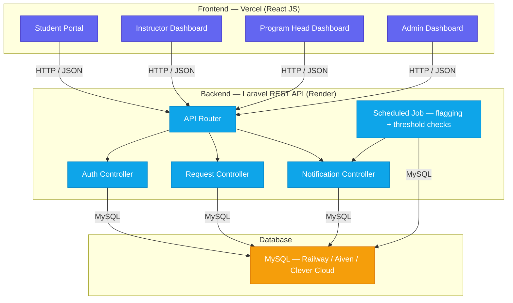

# ALRM — Absenteeism, Late Report, and Excuse Letter Management System

A web-based Absence/Tardiness Monitoring and Approval System for **La Verdad Christian College, Inc.**, replacing the current manual, form-by-form routing done through Google Forms, spreadsheets, and Viber.

> ALRM does not change *who* decides on attendance validity — Instructors and Program Heads keep that authority. ALRM's job is to **route requests automatically, track status in real time, and flag bottlenecks** before they turn into overlooked cases or compliance violations.

---

## 📋 Table of Contents
- [Overview](#overview)
- [Tech Stack](#tech-stack)
- [Deployment Architecture](#deployment-architecture)
- [User Roles](#user-roles)
- [Getting Started](#getting-started)
- [Project Structure](#project-structure)
- [Implementation Phases (To-Do)](#implementation-phases-to-do)
- [Environment Variables](#environment-variables)

---

## Overview

| | |
|---|---|
| **Problem** | Manual, one-by-one routing (College Secretary → Instructor via Viber) causes delays, no visibility into who's responded, and no early warning as a student's absence/late count climbs. |
| **Solution** | Auto-route excuse/late requests to the correct instructor based on schedule, give every role a real-time dashboard, and auto-flag stale requests for follow-up. |
| **Core policy logic** | 3 lates = 1 absence · alerts fire at 2 absences (warning) and 3 absences (IR/minor offense) |

### Email Domains

| User type | Domain | Role |
|---|---|---|
| Student | `@student.laverdad.edu.ph` | `student` |
| Faculty / Staff | `@laverdad.edu.ph` | `instructor` / `program_head` / `administrator` (assigned by Admin on approval) |

Registration is rejected for any email outside these two domains. Staff accounts land as `pending` and the Administrator assigns the specific role during approval, since the staff domain alone doesn't distinguish Instructor from Program Head from Admin.

---

## Tech Stack

| Layer | Technology |
|---|---|
| Frontend | **React JS** |
| Backend / API | **Laravel** |
| Database | **MySQL** |
| Styling | Tailwind CSS *(or your chosen UI library)* |
| Frontend hosting | Vercel |
| Backend hosting | Render |
| Database hosting | Railway / Aiven / Clever Cloud *(free MySQL — Render free tier has no persistent disk)* |

> Stack is **fixed** per the course's Technical Requirements Guide: React JS + Laravel, frontend and backend must be separate deployed applications communicating over REST.

---

## Deployment Architecture



**Request flow (happy path):**
`Student submits request` → `Laravel auto-resolves instructor via class schedule` → `Instructor approves/notes/invalids` → `Dashboard updates in real time` → `If unanswered past deadline → auto-flagged to Program Head` → `Email + in-app notification fires at every step`

---

## User Roles

| Role | Can do |
|---|---|
| **Student** | Register (pending admin approval) · submit excuse/late requests · upload evidence · track own status & threshold history |
| **Instructor** | Review requests for own classes · approve / note / invalid · manually log attendance · view class-level dashboard |
| **Program Head** | View program-wide (all instructors/sections) · monitor flagged students · receive auto-escalated requests |
| **Administrator** | College-wide visibility · approve registrations · manage programs/subjects/schedules · export reports |

---

## Getting Started

### Backend (Laravel)
```bash
cd backend
composer install
cp .env.example .env
php artisan key:generate
# set DB_* values in .env
php artisan migrate --seed
php artisan serve
```

### Frontend (React)
```bash
cd frontend
npm install
# set VITE_API_URL (or REACT_APP_API_URL) to point to your Laravel API
npm run dev
```

---

## Project Structure

```
alrm/
├── backend/                 # Laravel API
│   ├── app/Http/Controllers/
│   ├── app/Models/
│   ├── database/migrations/
│   ├── database/seeders/
│   └── routes/api.php
└── frontend/                # React JS
    ├── src/pages/
    │   ├── student/
    │   ├── instructor/
    │   ├── program-head/
    │   └── admin/
    ├── src/components/
    └── src/api/
```

---

## Implementation Phases (To-Do)

### Phase 1 — Backend Foundation
- [ ] Migrations: `user`, `programs`, `classes`, `enrollments`, `attendance_tracker`, `requests`, `followup_flags`, `notifications`, `audit_log`
- [ ] Eloquent models + relationships
- [ ] Role-based auth (self-registration + email domain validation + admin approval + middleware guards)
- [ ] Auto-routing logic: excuse request → correct instructor via schedule lookup
- [ ] Threshold engine: 3 lates → 1 absence, 2/3-absence count triggers
- [ ] Scheduled job for follow-up flagging (unanswered requests past deadline)
- [ ] Seed database with **real** LVCC programs/subjects/accounts — no placeholder/test data

### Phase 2 — Frontend Core
- [ ] Login / Register pages
- [ ] Student: submit request form, request history, threshold tracker
- [ ] Instructor: pending requests list, decision actions, class dashboard
- [ ] Program Head: aggregated program dashboard, flagged-students view
- [ ] Admin: user approval queue, CRUD for programs/subjects/schedules, dashboard

### Phase 3 — Notifications & Reporting
- [ ] Email notifications (new request, decision made, threshold warning, follow-up flag)
- [ ] In-app notification bell/list
- [ ] Exportable reports (PDF/Excel) for accreditation
- [ ] Audit trail viewer (admin-facing)

### Phase 4 — Polish & Deploy
- [ ] Form validation + error states (frontend & backend)
- [ ] Loading/empty states across all dashboards
- [ ] Deploy backend → Render, frontend → Vercel, DB → Railway/Aiven/Clever Cloud
- [ ] End-to-end test on deployed URLs with real seeded data
- [ ] Mobile browser test (student flow)
- [ ] Confirm login/test credentials are ready for evaluators

### Phase 5 — Optional Enhancements (post-presentation)
- [ ] SSO via Google Workspace (`@student.laverdad.edu.ph`)
- [ ] SMS/Viber as an additional notification channel
- [ ] Multi-role account support (e.g., Instructor who is also Program Head)
- [ ] Term-over-term analytics/trend charts

---

## Environment Variables

**Backend (`.env`)**
```
DB_CONNECTION=mysql
DB_HOST=
DB_PORT=
DB_DATABASE=alrm
DB_USERNAME=
DB_PASSWORD=
MAIL_MAILER=smtp
MAIL_HOST=
MAIL_USERNAME=
MAIL_PASSWORD=
```

**Frontend (`.env`)**
```
VITE_API_URL=https://your-laravel-api.onrender.com/api
```