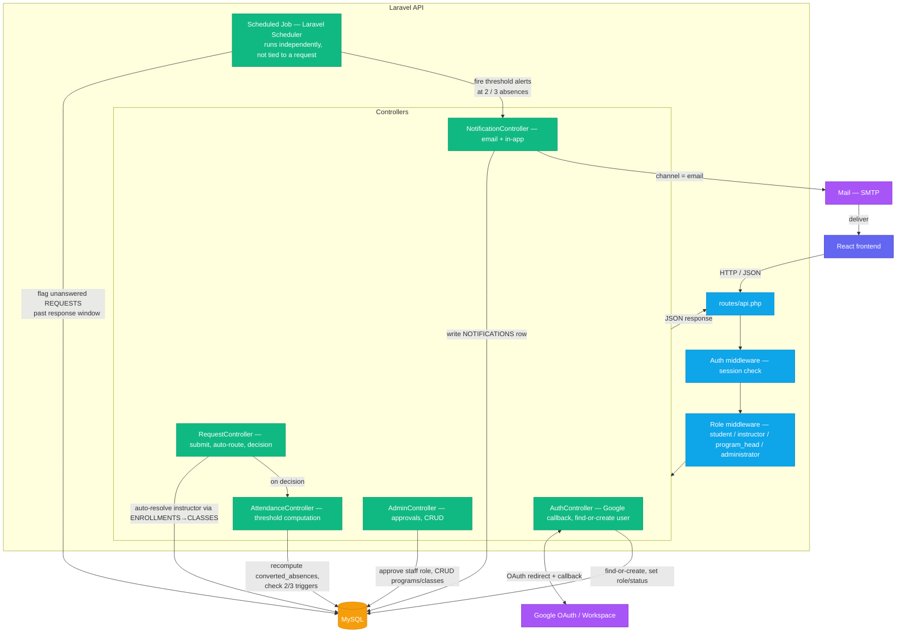

# ALRM — Backend Implementation Guide
### Laravel API Documentation & TODO (v1.0 / MVP)

> This is the backend-only companion to `ALRM.md`. Purpose: a working guide while building the Laravel API — what already exists, what's missing, and in what order things should be done.

---

## 1. Scope Reminder

The backend (Laravel REST API) is responsible for:
- Auth + role-based access (4 roles only: **Administrator, Program Head, Instructor, Student** — no College Secretary role; that manual relay function is automated away by the system)
- Auto-routing excuse/late requests to the correct instructor (based on schedule, not manual)
- Policy enforcement: 3 lates = 1 absence; alerts at 2 absences (warning) and 3 absences (IR/minor offense)
- Follow-up flagging (scheduled job) when a request goes unanswered past the response window
- Notifications (email + in-app)
- Reports/exports and audit trail

**Not in scope here (frontend's job):** UI/UX, dashboards, React-side routing, styling.

---

## 2. Tech Stack (Backend)

| Layer | Technology | Note |
|---|---|---|
| Framework | **Laravel 13** (PHP ^8.3) | per `composer.json` |
| Database | **MySQL** (production) / SQLite (local dev default) | ⚠️ needs to be switched to MySQL in `.env` before deploying |
| Auth | **Google OAuth/SSO (Laravel Socialite)** + custom role-based middleware | ⚠️ **Scope change (see §9):** moved up from Phase 2 to MVP. No more email/password registration form — login/account creation happens via "Sign in with Google", restricted to LVCC's Workspace domains. Not set up yet, needs to be built. |
| Mail | Laravel Mail (SMTP) | `.env` already has `MAIL_*` vars, currently on `log` driver |
| Hosting | Render | `.env` should point `DB_*` to an external MySQL host (Railway/Aiven/Clever Cloud) — **not** Render's own disk, since the free tier has no persistent storage |

---

## 3. Backend Architecture

How a request actually flows through the Laravel API — routing, auth, business logic, and the scheduled job that runs independently of any request.



**Key points this diagram is enforcing:**
- **Auth is a redirect dance, not a form POST** — the browser leaves the app, goes to Google, comes back to `AuthController`'s callback. Domain validation happens *inside* that callback, every time, not just at "registration."
- **The scheduled job is decoupled from the request/response cycle.** It's the only thing in this system that runs on its own timer (Laravel Scheduler → cron), not triggered by a user action. This is what powers follow-up flagging and threshold notifications — don't try to compute those inline inside a controller.
- **`RequestController` never asks the client who the instructor is.** It resolves that itself via `ENROLLMENTS → CLASSES.instructor_id`, per the auto-routing requirement.
- **`NotificationController` sits between the job/controllers and two different outputs** (DB row for in-app, Mail for email) — both driven by the same `channel` field on `NOTIFICATIONS`, so a single alert can go out both ways without duplicating logic.

---

## 4. Current State (as of this scan)

Based on the files found in `/backend`:
- ✅ All migrations created (PROGRAMS, CLASSES, ENROLLMENTS, ATTENDANCE_TRACKER, REQUESTS, FOLLOWUP_FLAGS, NOTIFICATIONS, AUDIT_LOG), plus role/status columns on `users`
- ✅ Eloquent models created for each table + relationships
- ✅ `routes/api.php` created and registered in `bootstrap/app.php` (`withRouting`)
- ✅ Auth & Role System done: Socialite (Google) configured, `AuthController` (redirect/callback/logout/me), `RoleMiddleware` (per-role guard), `Admin/UserApprovalController` (staff-only approve queue)
- ❌ No scheduled job yet (threshold checks + follow-up flagging)
- ❌ Core business logic not yet built: request submission/auto-routing, threshold engine, instructor decision endpoint, student history/summary endpoints

**Priority 1 and Priority 2 are complete. Priority 3 — Core Business Logic — is next.**

---

## 5. Database Schema (Backend Responsibility)
 
> All migrations are ✅ done. This section is now reference-only — schema is finalized and matches the ERD.
 
### `users`
| Field | Type | Notes |
|---|---|---|
| id | bigint (PK) | ✅ |
| google_id | string, nullable | ✅ — Google's unique subject ID, used to match returning users on login |
| name | string | ✅ — populated from Google profile on first login |
| email | string, unique | ✅ — validated in callback: `@student.laverdad.edu.ph` = student, `@laverdad.edu.ph` = staff |
| role | enum, nullable | ✅ — `administrator`, `program_head`, `instructor`, `student`. Auto-set to `student` for student domain; null for staff until Admin assigns. |
| program_id | bigint (FK → programs), nullable | ✅ |
| status | enum, nullable | ✅ — `approved` (auto for students) or `pending` (staff, until Admin assigns role) |
| password | string, nullable | ✅ — kept nullable since accounts are created via Google OAuth |
 
### `programs`
| Field | Type | Notes |
|---|---|---|
| id | bigint (PK) | ✅ |
| program_name | string | ✅ |
| program_head_id | bigint (FK → users), nullable | ✅ — nullOnDelete |
 
### `classes`
| Field | Type | Notes |
|---|---|---|
| id | bigint (PK) | ✅ |
| subject_name | string | ✅ |
| instructor_id | bigint (FK → users) | ✅ — cascadeOnDelete |
| schedule | string | ✅ |
| program_id | bigint (FK → programs) | ✅ — cascadeOnDelete |
 
### `enrollments`
| Field | Type | Notes |
|---|---|---|
| id | bigint (PK) | ✅ |
| student_id | bigint (FK → users) | ✅ — cascadeOnDelete |
| class_id | bigint (FK → classes) | ✅ — cascadeOnDelete |
 
### `attendance_tracker`
| Field | Type | Notes |
|---|---|---|
| id | bigint (PK) | ✅ |
| enrollment_id | bigint (FK → enrollments) | ✅ — cascadeOnDelete. One tracker per student per class, resolved through enrollment. |
| total_lates | unsignedInteger, default 0 | ✅ |
| total_absences | unsignedInteger, default 0 | ✅ |
| converted_absences | unsignedInteger, default 0 | ✅ — recomputed as `total_absences + floor(total_lates / 3)` on every update |
| status | enum | ✅ — `safe`, `warning` (2 converted absences), `IR` (3 converted absences) |
 
### `requests`
| Field | Type | Notes |
|---|---|---|
| id | bigint (PK) | ✅ |
| enrollment_id | bigint (FK → enrollments) | ✅ — cascadeOnDelete. Resolves student + class + instructor automatically. |
| type | enum | ✅ — `absence`, `late` |
| date_of_absence | date | ✅ |
| reason | text | ✅ |
| evidence_file_url | string, nullable | ✅ |
| status | enum, default `pending` | ✅ — `pending`, `approved`, `noted`, `invalid` |
| date_reviewed | timestamp, nullable | ✅ |
| reviewed_by | bigint (FK → users), nullable | ✅ — nullOnDelete |
 
### `followup_flags`
| Field | Type | Notes |
|---|---|---|
| id | bigint (PK) | ✅ |
| request_id | bigint (FK → requests) | ✅ — cascadeOnDelete |
| flagged_at | timestamp | ✅ |
| escalated_to | bigint (FK → users) | ✅ — cascadeOnDelete (the Program Head receiving the escalation) |
| status | enum, default `open` | ✅ — `open`, `resolved` |
 
### `notifications`
| Field | Type | Notes |
|---|---|---|
| id | bigint (PK) | ✅ |
| user_id | bigint (FK → users) | ✅ — cascadeOnDelete |
| request_id | bigint (FK → requests), nullable | ✅ — nullOnDelete |
| type | string | ✅ — e.g. `new_request`, `threshold_warning`, `follow_up_flag` |
| message | text | ✅ |
| channel | enum | ✅ — `email`, `in_app` |
| date_sent | timestamp, useCurrent | ✅ |
| is_read | boolean, default false | ✅ |
 
### `audit_log`
| Field | Type | Notes |
|---|---|---|
| id | bigint (PK) | ✅ |
| user_id | bigint (FK → users) | ✅ — cascadeOnDelete (the actor) |
| action | string | ✅ — e.g. `approved_request`, `flagged_request` |
| table_affected | string | ✅ — polymorphic: which table the action touched |
| record_id | unsignedBigInteger | ✅ — the specific record's ID in that table |
| timestamp | timestamp, useCurrent | ✅ |
---

## 6. API Endpoints (target — `routes/api.php`)

> `routes/api.php` doesn't exist yet — that file itself needs to be created before adding any endpoints.

### Auth
```
GET   /api/auth/google/redirect    → sends the user to Google's OAuth consent screen
GET   /api/auth/google/callback    → Google redirects back here with the auth code;
                                      validate domain, find-or-create the user, issue session
POST  /api/logout
GET   /api/me
```
> No more `POST /api/register` or a password-based `POST /api/login` — account creation and login both happen through the Google callback. First-time sign-in = account creation; returning sign-in = login. Domain validation still runs on every callback, not just once.

### Student
```
GET   /api/classes                    → enrolled classes
POST  /api/requests                   → auto-route via ENROLLMENTS → CLASSES.instructor_id
GET   /api/requests                   → own history
GET   /api/requests/{id}
GET   /api/attendance/summary         → own tracker
```

### Instructor
```
GET   /api/instructor/requests?status=pending
PATCH /api/instructor/requests/{id}/decision   → approved | noted | invalid
GET   /api/instructor/dashboard
```

### Program Head
```
GET   /api/program-head/dashboard
GET   /api/program-head/students/flagged
GET   /api/program-head/requests
```

### Administrator
```
GET    /api/admin/dashboard
GET    /api/admin/users
PATCH  /api/admin/users/{id}/approve   → assigns staff role if @laverdad.edu.ph
CRUD   /api/admin/programs
CRUD   /api/admin/classes
GET    /api/admin/reports/export
```

**Business logic reminders:**
- On `POST /api/requests`, the instructor is auto-resolved through relationships — **never** taken from user input.
- Every decision/submission → update `ATTENDANCE_TRACKER`, recompute `converted_absences`, check against the 2/3 triggers.
- Scheduled job (Laravel Task Scheduling): (1) insert a `FOLLOWUP_FLAGS` row when a request passes its response window, (2) fire `NOTIFICATIONS` at 2 and 3 converted absences.

---

## 7. Environment Variables (Backend)

```
DB_CONNECTION=mysql
DB_HOST=
DB_PORT=
DB_DATABASE=alrm
DB_USERNAME=
DB_PASSWORD=
MAIL_MAILER=smtp
MAIL_HOST=
MAIL_USERNAME=
MAIL_PASSWORD=
GOOGLE_CLIENT_ID=
GOOGLE_CLIENT_SECRET=
GOOGLE_REDIRECT_URI=
```
⚠️ The current `.env.example` still defaults to `DB_CONNECTION=sqlite` — switch this over once MySQL is set up.
⚠️ `GOOGLE_*` vars are new — needed for Laravel Socialite. Get these from the Google Cloud Console OAuth client (the one currently set to "Internal" user type, restricted to LVCC's Workspace).

---

## 8. TODO — Priority Order

> Follow this top-to-bottom. Don't skip ahead — many steps here depend on earlier ones (e.g. you can't build the threshold engine without the `ATTENDANCE_TRACKER` migration existing first).

### 🔴 Priority 1 — Foundation (do this before anything else)
- [x] All migrations created and in correct order
- [x] `attendance_tracker` uses `enrollment_id` FK (not separate `student_id` + `class_id`)
- [x] `add_program_id_foreign_to_users_table` — FK constraint added after `programs` table exists
- [x] Create Eloquent models for each table + relationships (hasMany/belongsTo per the ERD)
- [x] Create `routes/api.php`, register it in `bootstrap/app.php` (`withRouting`)

### 🟠 Priority 2 — Auth & Role System (Google SSO) ✅ DONE
- [x] Install & configure Laravel Socialite with the Google driver
- [x] `GET /api/auth/google/redirect` — kick off the OAuth flow
- [x] `GET /api/auth/google/callback` — handle the return trip:
  - Validate the email domain (`@student.laverdad.edu.ph` vs `@laverdad.edu.ph`); reject anything outside both, even if Google auth itself succeeded
  - Find-or-create the user by `google_id` / email
  - **Student email** → create with `role = student`, `status = approved` immediately, no manual step
  - **Staff email** → create with `role = null`, `status = pending` — waits for Admin to assign the specific role
  - Issue the session and log the user in
- [x] `POST /api/logout`, `GET /api/me`
- [x] Role-based middleware (guard per role: student/instructor/program_head/administrator)
- [x] `PATCH /api/admin/users/{id}/approve` — **now staff-only.** This is where the specific staff role (Instructor/Program Head/Administrator) gets assigned; students never appear in this queue anymore since they're auto-approved on first login

### 🟡 Priority 3 — Core Business Logic
- [ ] `POST /api/requests` — auto-resolve instructor via `ENROLLMENTS → CLASSES.instructor_id`
- [ ] Threshold engine: update `ATTENDANCE_TRACKER` on request decision/submission, compute `converted_absences`, check against the 2/3 triggers
- [ ] Instructor decision endpoint (`PATCH /api/instructor/requests/{id}/decision`)
- [ ] Student endpoints: history, attendance summary

### 🟢 Priority 4 — Automation
- [ ] Scheduled job: follow-up flagging (unanswered request past response window → `FOLLOWUP_FLAGS`)
- [ ] Scheduled job / event: threshold notifications (2 absences = warning, 3 = IR) → `NOTIFICATIONS` table with `channel`
- [ ] Email notifications via Laravel Mail (submission, decision, threshold, follow-up)

### 🔵 Priority 5 — Program Head & Admin Views
- [ ] Program Head endpoints: aggregated dashboard, flagged students, program-wide requests
- [ ] Admin CRUD: programs, classes
- [ ] Admin dashboard (college-wide)
- [ ] Reports export (PDF/Excel)
- [ ] Audit trail viewer/logging (write to `AUDIT_LOG` on every significant action)

### ⚪ Priority 6 — Seeding, Testing, Deploy Prep
- [ ] Seeders — **real** LVCC programs/subjects/accounts (no placeholder/"John Doe" data — this is a requirement in the README)
- [ ] Switch `.env` to MySQL (test locally first) before deploying to Render
- [ ] Basic Feature tests per endpoint (auth, routing logic, threshold logic)
- [ ] Point the production `.env` to an external MySQL host (Railway/Aiven/Clever Cloud) — Render's free tier has no persistent disk

---

## 9. Consistency Checks (always check before coding)

- ⚠️ The role list is **fixed at 4**: Administrator, Program Head, Instructor, Student. Do not add a "College Secretary" role — that function is already automated away in the design.
- ⚠️ Threshold logic is **count-based**, not percentage-of-sessions. Do not add session-by-session attendance logging — that was intentionally removed from scope.
- ⚠️ The instructor on a request is always **auto-resolved**, never manual/user-input.
- ⚠️ Table names should follow the ERD naming (`PROGRAMS`, `CLASSES`, etc.) — don't rename them arbitrarily.
- ⚠️ Auth is **Google OAuth/SSO only** — no password-based registration form. See §10 for why this changed from the original `ALRM.md`.
- ⚠️ The User Approval Queue is **staff-only** now. Students are auto-approved on first Google login — don't build a student approval UI/endpoint.

---

## 10. Scope Change Log

Keeping a record here since this contradicts what's written in the original `ALRM.md`.

**Original `ALRM.md` decision (§2, §8):**
> Self-registration via email/password → account lands as `pending` → Admin manually approves everyone (student and staff). SSO via Google Workspace was explicitly listed under *"Deferred to Phase 2 (not in MVP)."*

**New decision (this conversation):**
> Google OAuth/SSO is **moved into the MVP**, replacing the email/password registration form entirely. Reasoning: LVCC's Google Cloud OAuth client is set to **"Internal"** user type, meaning only accounts within LVCC's own Google Workspace can authenticate at all — Google itself becomes the identity verification gate before a request ever reaches ALRM. Combined with the fact that the student email domain already resolves the role unambiguously, this removes the original reason for a manual approval step **for students specifically**.
>
> Staff accounts still land as `pending` and still go through the Admin queue — but now the *reason* for that step is narrower: it's purely role assignment (Instructor vs Program Head vs Administrator), not identity/legitimacy verification, since Google/Workspace already handled that part.

**Still needs confirming with you:**
- Are `@student.laverdad.edu.ph` and `@laverdad.edu.ph` on the **same Google Workspace customer/org**? If they're separate orgs, the "Internal" restriction on one OAuth client may not automatically cover both domains — worth double-checking in Google Cloud Console before building on this assumption.
- Should `ALRM.md` itself be updated to match (move the SSO bullet out of "Deferred to Phase 2"), or do you want to keep `ALRM.md` as the original proposal doc and treat this file as the up-to-date implementation reality? Flagging this so the two docs don't quietly drift apart.