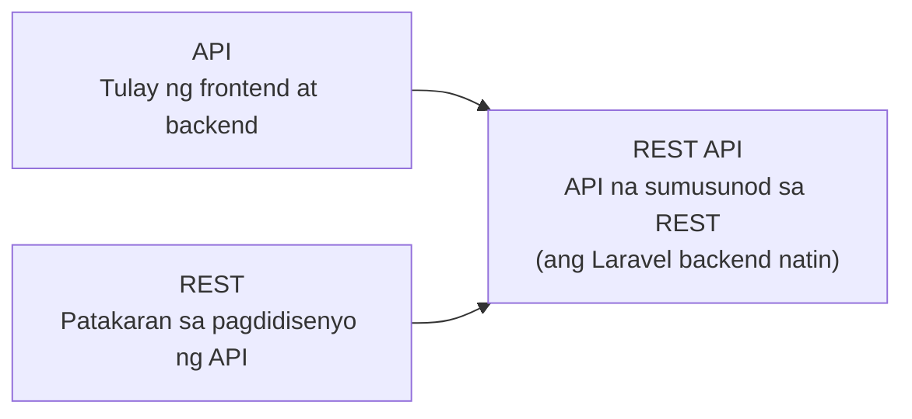
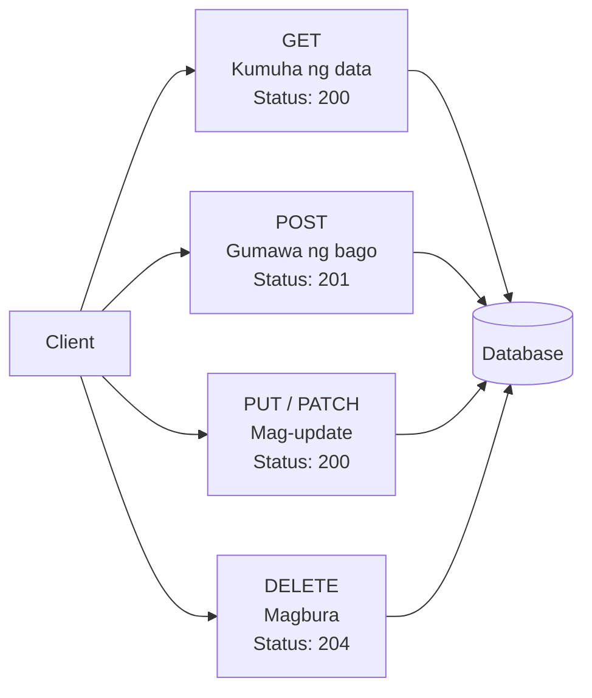
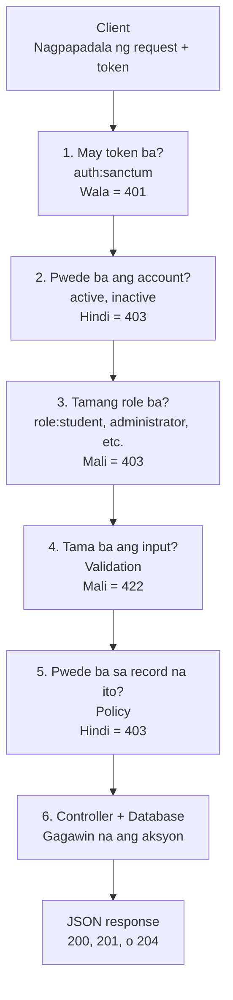
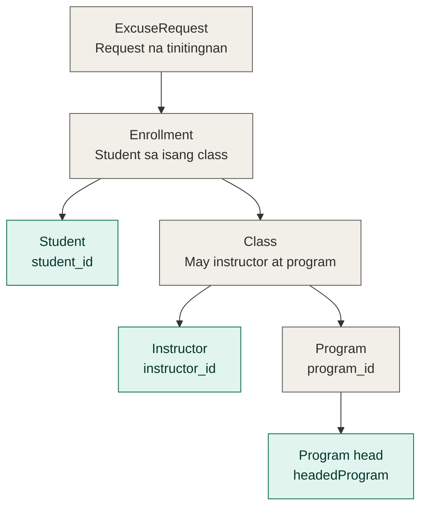
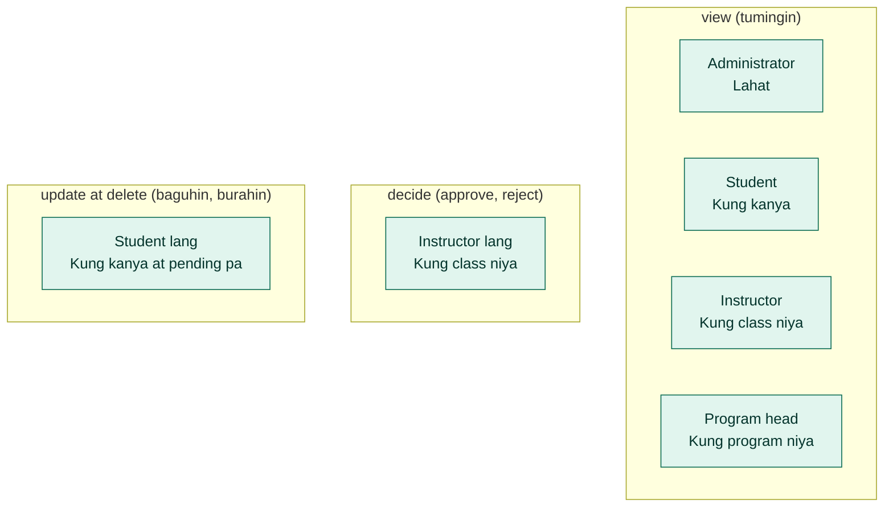

# Architecture ng REST API

Ang dokumentong ito ay nagpapaliwanag kung paano gumagana ang Laravel REST API ng sistema. Ang mga diagram ay naka-Mermaid, kaya makikita ang mga ito nang diretso sa GitHub o sa VS Code na may Mermaid preview.

---

## 1. Ano ang API, REST, at REST API?

- **API** ay ang tulay ng frontend at backend. Ang frontend ay nagpapadala ng request at ang backend ay nagbabalik ng response.
- **REST** ay istilo o patakaran sa pagdidisenyo ng API: resource-based ang URL, HTTP method ang nagsasabi ng aksyon, stateless, at JSON ang format ng data.
- **REST API** ay ang API na sumusunod sa mga patakaran ng REST.

---

## 2. Ang apat na HTTP methods

| Method | Aksyon | CRUD | Halimbawa sa routes | Status |
|---|---|---|---|---|
| GET | Magbasa | Read | `GET /requests/5` | 200 |
| POST | Gumawa | Create | `POST /requests` | 201 |
| PUT / PATCH | Mag-update | Update | `PATCH /requests/5` | 200 |
| DELETE | Magbura | Delete | `DELETE /requests/5` | 204 |

Pareho ang URL (`/requests/5`) sa GET, PATCH, at DELETE. Ang method ang nagpapasya sa aksyon.

- **PUT** ay pinapalitan ang buong record, kaya kailangang ipadala ang lahat ng field.
- **PATCH** ay binabago lang ang isa o ilang field.

---

## 3. Ano ang nangyayari sa isang request

Basahin ito mula taas pababa na parang pila sa gate. Kapag bumagsak ang request sa kahit anong hakbang, hihinto agad doon at magbabalik ng JSON error.

- Ang hakbang 1 hanggang 3 ay ang `middleware` sa routes (`auth:sanctum`, `active`, `inactive`, `role:...`).
- Ang hakbang 4 ay ang validation (`FormRequest`).
- Ang hakbang 5 ay ang `ExcuseRequestPolicy`.
- Ang `throttle` ay nasa login, OTP, at evidence upload routes lang.

---

## 4. Paano nahahanap ng policy kung sino ang kaugnay ng request

Gray ang mga data at teal ang mga taong tinitingnan ng policy. Ang daan mula sa request pababa ang ginagamit ng code, halimbawa `$excuseRequest->enrollment->class->instructor_id`. Walang check para sa administrator dahil palagi siyang pwedeng tumingin.

---

## 5. Sino ang pwede sa bawat aksyon (`ExcuseRequestPolicy`)

Ang mga nakalista lang ang pwede. Ang hindi nakalista ay bawal at makakatanggap ng `403`.

| Policy method | Resulta |
|---|---|
| `viewAny`, `create`, `restore`, `forceDelete` | Palaging `false` |
| `view` | Administrator, student na may-ari, instructor ng class, program head ng program |
| `decide` | Instructor ng class lang |
| `update`, `delete` | Student na may-ari lang, at `pending` pa ang status |

---

## RoleMiddleware vs Policy

| | Antas | Tinatanong nito |
|---|---|---|
| `RoleMiddleware` | Sa route, bago ang controller | Tama ba ang klase ng user para sa buong group ng routes? |
| `ExcuseRequestPolicy` | Sa record, sa loob ng controller | Pwede ba ang user sa mismong request na ito? |

Halimbawa, kung sa ibang student ang request #5, makakatanggap ng `403` ang isang student kahit tama ang role niya. Ito ang dahilan kung bakit kailangan ang policy at hindi sapat ang role lang.